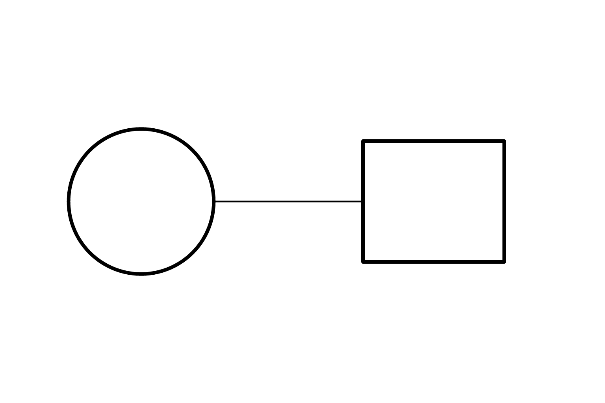
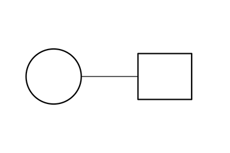
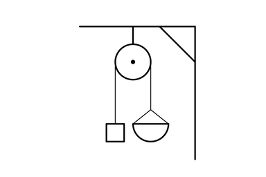
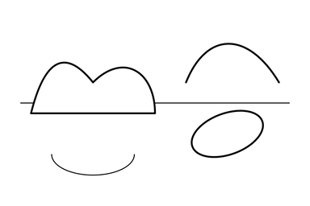
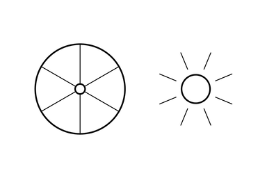
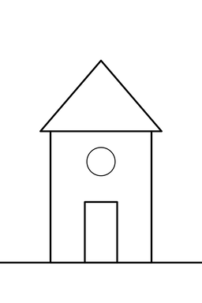
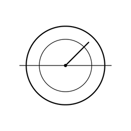

# layout-sketch

[](https://github.com/poik76107/layout-sketch/actions/workflows/ci.yml)
[](https://github.com/poik76107/layout-sketch/releases/latest)
[](LICENSE)

Image generators can struggle with exact composition. An agent writes coordinates, and the `sketch` executable renders a layout and a preview for the agent to inspect. The reviewed clean full-size PNG guides the image generator's composition; the final geometry may differ.

[](docs/images/01-basic.png)

Save this complete scene as `scene.json` in a fresh working directory:

```json
{
  "schema_version": 1,
  "canvas": "landscape",
  "shapes": [
    {"id": "connector", "type": "line", "from": [53, 50], "to": [90, 50], "width": "thin"},
    {"id": "left-object", "type": "circle", "cx": 35, "cy": 50, "r": 18, "fill": "white"},
    {"id": "right-object", "type": "rect", "x": 90, "y": 35, "w": 35, "h": 30, "fill": "white"}
  ]
}
```

[Install sketch](#install), then run from that directory:

```sh
sketch scene.json -o main.png --preview preview.png
```

## Install

Download the archive for your platform from the [latest release](https://github.com/poik76107/layout-sketch/releases/latest) (Linux x86_64/arm64, macOS arm64, Windows x86_64), unpack it and put `sketch` on your `PATH`. Each archive also contains the agent skill. Or build from source:

```sh
cargo install --git https://github.com/poik76107/layout-sketch --locked
```

See the [installation guide](docs/install.md) for details.

## Gallery

Each preview links to its clean full-size PNG; the scene link opens its source JSON.

| Basic | Pulley | Curves |
| --- | --- | --- |
| [](docs/images/01-basic.png) [Scene JSON](skills/layout-sketch/assets/examples/01-basic.json) | [](docs/images/02-pulley.png) [Scene JSON](skills/layout-sketch/assets/examples/02-pulley.json) | [](docs/images/03-curves.png) [Scene JSON](skills/layout-sketch/assets/examples/03-curves.json) |
| [](docs/images/04-group-repeat.png) [Scene JSON](skills/layout-sketch/assets/examples/04-group-repeat.json) | [](docs/images/05-portrait.png) [Scene JSON](skills/layout-sketch/assets/examples/05-portrait.json) | [](docs/images/06-square.png) [Scene JSON](skills/layout-sketch/assets/examples/06-square.json) |

[Regenerate the gallery](docs/images/README.md).

## Use with AI agents

For Claude Code, Codex or OpenCode, install the `sketch` executable and copy the complete [layout-sketch skill](skills/layout-sketch/) into your client's skill directory. See [skill installation](docs/install.md#install-the-skill) for destinations and the image-generation handoff.

## CLI usage

The command above renders a scene and its preview. See the [CLI guide](docs/cli.md), including [help](docs/cli.md#cli-help) and [reproducible diagnostics](docs/cli.md#reproducible-diagnostics).

## Scene overview

Canvas options are landscape (150×100 units, 1536×1024 pixels), portrait (100×150, 1024×1536) and square (100×100, 1024×1024). Origin is top left, X goes right, Y goes down, and one unit is 10.24 pixels. Nine primitives are `line`, `polyline`, `polygon`, `rect`, `circle`, `ellipse`, `arc`, `curve`, and `path`. Groups mirror, scale, rotate and translate; `repeat_rotate` makes radial copies. Strokes are fixed black thick (9 px) or thin (4.5 px), and fills are none, white or black. Shapes paint in array order, back to front, fill then stroke.

Bounds warnings include strokes; `allow_clip` suppresses selected edge warnings. Input is limited to 4 MiB, 10,000 expanded primitives, repeat counts 1..256 and 65,536 bytes of path `d`. Each painted path has an inclusive limit of 2^24 = 16,777,216 px per axis for outward-rounded bounds after transforms and stroke expansion, including filled source paths. `allow_clip` never bypasses this hard geometry limit. See the [full reference and schema](docs/scene-format.md).

## Limitations

No text, colors, transparency, raster input, automatic layout, scene semantics, physics or overlap validation, or full SVG support. This tool draws layouts; it does not generate final artwork.

## License

[MIT](LICENSE).
